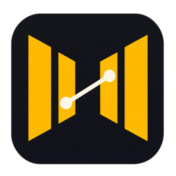

# ClickHouse RAG

ClickHouse RAG is a Python framework for finding and citing evidence in
ClickHouse. Index documents with embeddings and optional relationship facts.
Run hybrid search, follow relationships across documents, or execute a typed
knowledge plan. The same namespace and metadata filters scope each operation.

Use the [quickstart](quickstart.md) to run hybrid retrieval or the
[framework quickstart](framework.md) for GraphRAG, KAG and local models.
If you have an existing 0.x installation, see the [migration guide](migration.md).
The [operations guide](operations.md) covers access, consistency and sizing.
